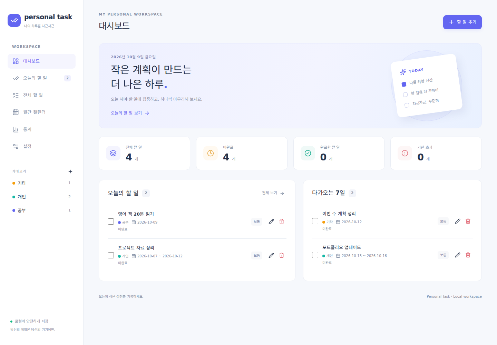

# personal-task

현재 버전: 1.1.0

나의 하루를 차근차근 정리하는 한국어 개인용 할 일 관리 앱입니다. 로그인과 클라우드 연결 없이, Windows PC의 브라우저에서 사용합니다. 작업 데이터는 기기의 IndexedDB에만 저장됩니다. 외부 폰트·분석 서비스·원격 API를 사용하지 않습니다.

## 주요 기능 및 화면

| 화면         | 기능                                                            |
| ------------ | --------------------------------------------------------------- |
| 대시보드     | 전체·미완료·완료·기한 초과 건수, 오늘의 할 일, 다가오는 7일     |
| 오늘의 할 일 | 오늘 진행 중인 기간 일정·종료 일정과 기한 초과를 별도 표시                 |
| 전체 할 일   | 추가·수정·삭제·완료·완료 취소, 메모 검색, 복합 필터, 5가지 정렬 |
| 월간 캘린더  | 이전·다음·이번 달, 날짜별 목록, 선택 날짜를 마감일로 추가       |
| 통계         | 실제 완료 시각에 따른 주간·월간 건수, 날짜별 차트와 표          |
| 설정         | 시스템·라이트·다크 테마, 카테고리, 반복 종료, JSON 백업·복원    |

마감일은 선택 사항이며 반복 작업에는 필수입니다. 우선순위는 높음·보통·낮음이며, 기본값은 보통입니다. 기본 카테고리는 공부·개인·기타입니다. 카테고리 삭제 시 해당 할 일과 반복 템플릿은 트랜잭션 안에서 미분류로 전환됩니다. 할 일은 삭제하지 않습니다.

## 화면 미리보기

아래는 검증용 예시 데이터 화면이며, 앱을 처음 열면 빈 작업 목록으로 시작합니다.



## 1.1 업데이트 및 적용 방법

실행 중인 CMD 창에서 Ctrl+C로 서버를 종료한 뒤, 새 ZIP을 **새 폴더**에 압축 해제합니다. 새 personal-task 폴더의 탐색기 주소창에서 cmd를 열고 아래 명령을 실행합니다. .cmd 파일이 스마트 앱 컨트롤에서 차단되는 경우에도 이 실행 방법을 사용할 수 있습니다.

```cmd
node scripts\serve.mjs
```

같은 브라우저 프로필의 http://127.0.0.1:5173 주소로 접속하면 기존 IndexedDB 데이터가 유지되며 자동 업그레이드됩니다. 다른 탭도 닫고 업데이트한 뒤 다시 여는 것이 좋습니다. 기존 Git 작업 폴더를 덮어쓰거나 브라우저 데이터를 초기화할 필요는 없습니다.

### 일정 범위와 카테고리 관리

- 할 일 편집에서 **시작일 + 종료일(마감일)**을 지정합니다. 시작일은 종료일보다 늦을 수 없으며, 시작일을 입력하면 종료일도 필요합니다.
- 시작일 없이 종료일만 지정하면 기존과 같은 하루 일정입니다. 둘 다 비우면 날짜 미지정 작업입니다.
- 기간 일정은 시작일~종료일의 모든 날짜에 캘린더에 표시됩니다. 오늘 화면에는 오늘을 포함하는 미완료 일정이 표시되고, 기한 초과는 종료일이 지난 뒤 판단합니다.
- 날짜 범위 필터는 일정과 검색 범위가 하루라도 겹치면 표시합니다. 반복 기간은 종료일을 반복 기준으로 삼고 기간 길이를 유지하여 다음 시작일을 계산합니다.
- 일반 작업 완료는 상태와 완료 시각만 바꾸고 새 작업을 만들지 않습니다. 반복 작업은 최초 요구사항대로 다음 회차를 한 번 생성하며, **매일·매주·매월 / 회차 번호 / 다음 일정 생성 안내**로 구분합니다.
- 카테고리는 사이드바의 카테고리 관리 버튼 또는 전체 할 일의 **카테고리 관리**에서 자유롭게 추가·이름과 색상 수정·삭제할 수 있습니다. 설정 화면에서도 동일한 기능을 제공합니다.

## 기술 스택

React, TypeScript strict, Vite, Tailwind CSS, Dexie/IndexedDB, React Router HashRouter, Recharts, date-fns, dnd-kit, Lucide React를 사용합니다. 검증 도구는 ESLint, Vitest, React Testing Library, fake-indexeddb, Playwright입니다. package.json과 package-lock.json에 버전을 고정했습니다.

## Windows 설치 준비

1. [Node.js 공식 사이트](https://nodejs.org/)에서 **24 LTS**의 Windows Installer를 설치합니다. 기본 설정으로 설치하면 npm도 함께 설치됩니다.
2. 개발 및 GitHub 업로드에는 [Git for Windows](https://git-scm.com/download/win)를 설치합니다. 일반 앱 실행에는 Git이 필요하지 않습니다.
3. 코드 편집에는 [VS Code](https://code.visualstudio.com/)를 사용할 수 있습니다. 일반 실행에는 편집기가 필요하지 않습니다.
4. 설치 후 PowerShell 또는 CMD를 새로 엽니다. 다음 명령으로 설치를 확인합니다.

```powershell
node --version
npm --version
git --version
```

PowerShell에서 npm.ps1 실행 정책 오류가 나오면 아래 모든 명령에서 `npm`을 `npm.cmd`, `npx`를 `npx.cmd`로 바꿉니다. 실행 정책을 변경할 필요는 없습니다.

## 제공된 ZIP으로 바로 실행

ZIP에는 소스와 검증한 `dist/` 빌드 파일이 함께 들어 있습니다.

1. ZIP을 원하는 폴더에 압축 해제합니다.
2. 안의 `personal-task` 폴더에서 **start.cmd**를 더블클릭합니다.
3. 자동으로 열린 브라우저에서 `http://127.0.0.1:5173`을 사용합니다. 서버 준비 전에 열린 탭은 새로고침합니다.
4. 실행 중에는 CMD 창을 열어 둡니다. 종료는 창에서 **Ctrl+C**를 누릅니다.

이 실행 방식에는 설치된 Node.js만 필요합니다. npm 패키지를 내려받거나 인터넷에 접속하지 않습니다. 앱을 다시 사용하려면 start.cmd를 실행하면 됩니다. 컴퓨터 재부팅 뒤에도 같은 브라우저 프로필과 주소로 접속하면 데이터가 유지됩니다. index.html을 직접 더블클릭하는 file:// 방식은 지원하지 않습니다.

## 소스로 설치하거나 수정 후 실행

PowerShell·CMD 모두 프로젝트 폴더에서 실행합니다. 아래 경로는 자신의 압축 해제 위치에 맞게 바꿉니다. CMD에서는 다른 드라이브로 이동할 때 `cd /d "경로"`를 사용합니다.

```powershell
cd "C:\Users\MIN\Projects\personal-task"
npm ci
npm run build
npm start
```

`npm ci`는 최초 설치 때 인터넷 연결이 필요합니다. package-lock.json의 정확한 버전을 설치하므로 권장합니다. `npm install`도 사용할 수 있지만 설치 내용이 갱신될 수 있습니다.

일상 사용 주소는 **http://127.0.0.1:5173**입니다. 서버는 기기 내부의 127.0.0.1에만 연결됩니다. 같은 포트를 쓰는 서버는 동시에 실행할 수 없으며, 자동으로 다른 포트로 이동하지 않습니다. 5173 사용 중 오류가 나오면 이전 서버 창에서 Ctrl+C로 종료합니다.

### 개발 서버와 빌드 미리보기

```powershell
npm run dev
```

또는:

```powershell
npm run build
npm run preview
```

모두 같은 127.0.0.1:5173 주소를 사용합니다. 하나를 종료한 뒤 다른 명령을 실행합니다. 개발 서버는 코드 변경을 즉시 반영하고, start·preview는 마지막 빌드를 표시합니다. Vite 서버는 개발 및 확인용이며 일상 사용은 start.cmd 또는 npm start를 권장합니다.

`localhost`와 `127.0.0.1`은 서로 다른 저장 공간입니다. 포트나 프로토콜, 브라우저 프로필, 시크릿 창이 달라도 데이터가 달라집니다. 다른 주소로 옮길 때는 이전 주소에서 백업한 뒤 새 주소에서 복원합니다. 일반 모바일 기기에서는 PC의 127.0.0.1에 접근할 수 없습니다. 반응형 화면은 좁은 창이나 개발자 도구에서 확인할 수 있습니다.

## 데이터 저장 및 여러 탭

DB 이름은 `personal-task`, 현재 스키마 버전은 2입니다. 버전 1 데이터는 시작일을 비워 기존 날짜와 기록을 보존하는 자동 마이그레이션을 거칩니다. tasks·categories·groups·settings 테이블을 사용합니다. 완료 기록과 순서는 작업 자체에 저장하며 별도 집계 DB는 만들지 않습니다.

Dexie useLiveQuery를 통해 같은 origin과 프로필의 다른 탭에 변경을 반영합니다. 수정·완료·삭제·순서 변경은 저장된 version을 확인합니다. 오래된 모달이 감지되면 저장을 거부하고 입력을 유지합니다. 창을 닫아 최신 목록을 확인한 뒤 다시 수정합니다. 오류가 발생한 저장을 성공으로 표시하지 않습니다. 복원은 작업·카테고리 version과 별도의 generation 토큰을 갱신해, 삭제 후 재복원된 항목도 열린 편집창에서 덮어쓰지 못하게 합니다.

기기의 로컬 날짜를 사용하며 창 포커스와 30초 주기로 오늘 날짜를 갱신합니다. 완료 시각은 ISO 타임스탬프로 저장하고 통계에서는 로컬 시간대로 변환합니다. 주간 통계는 월요일~일요일입니다.

## 반복 일정 규칙과 수정 정책

- 매일·매주·매월을 지원하며 최초 마감일을 기준으로 유지합니다.
- 미완료 작업 때문에 새 작업을 자동 생성하지 않습니다. 완료했을 때만 다음 작업 하나를 생성합니다.
- 실제 완료 날짜 이후의 가장 가까운 예정일을 선택합니다. 미래 작업을 조기 완료하면 현재 발생 건 이후의 예정일을 사용해 같은 날짜를 중복 생성하지 않습니다.
- 1월 31일 기준 매월 반복은 2월 말일, 3월 31일로 이어집니다. 윤년은 2월 29일을 사용합니다. 1월 30일은 2월 말일 보정 후 3월 30일로 돌아옵니다.
- 작업 완료·시각 기록·다음 건 생성은 하나의 트랜잭션입니다. 동시에 완료하거나 재완료해도 다음 작업을 중복 생성하지 않습니다.
- 완료 취소는 현재 완료 시각만 제거합니다. 이미 만들어진 다음 작업은 유지하고 재완료에서 재사용합니다. 다음 건을 사용자가 삭제했더라도 재완료로 다시 생성하지 않습니다.
- 반복 편집은 현재 및 이후 **미완료** 발생 건과 그룹 템플릿에 반영합니다. 완료된 과거 기록은 변경하지 않습니다. 완료된 반복 발생 건을 편집하려면 먼저 완료를 취소합니다.
- 마감일을 바꾸면 해당 날짜를 새 기준으로 삼아 미완료 미래 일정을 다시 계산합니다. 반복 주기만 바꾸면 기존 기준일을 유지합니다.
- 미래 발생 건이 별도로 편집되어 그룹 revision이 다르면 이전 건의 편집을 **차단**합니다. 입력을 보존하며, 미래 발생 건을 먼저 확인하도록 안내합니다. 충돌 작업을 무조건 덮어쓰지 않습니다.
- 반복 안 함을 선택하거나 설정에서 반복 종료하면 이후 생성이 중단됩니다. 이미 만들어진 발생 건 및 완료 기록은 유지합니다.
- 발생 건 삭제는 반복 종료와 별개입니다. 모든 발생 건을 삭제해도 설정에 활성 반복 그룹이 남으며 직접 종료할 수 있습니다. 작업이 없으면 완료 이벤트도 없어 자동 생성은 일어나지 않습니다.

## 검색·필터·순서

제목·메모의 대소문자 구분 없는 검색과 상태·카테고리·우선순위·날짜 범위·미지정 마감일 필터를 함께 사용할 수 있습니다. 날짜 범위와 미지정 필터를 함께 적용하면 조건을 모두 만족하는 항목이 없으므로 빈 목록이 나옵니다.

정렬은 마감일 빠른/늦은 순, 우선순위 높은/낮은 순, 사용자 지정입니다. 마감일 없는 항목은 날짜 정렬에서 마지막입니다. 드래그는 검색과 필터가 없는 전체 목록의 사용자 지정 모드에서만 가능합니다. UI에 이 제한을 표시합니다. 핸들의 Space→방향키→Space 및 위·아래 버튼도 사용할 수 있습니다. 저장 순서는 재실행 후 유지됩니다.

## JSON 백업·복원

설정의 JSON 백업 버튼으로 파일을 다운로드합니다. 자동 백업이나 클라우드 동기화는 없습니다. 백업 파일을 직접 안전한 곳에 보관합니다.

복원은 JSON 복원에서 파일을 선택합니다. 형식 버전·타입·날짜·중복 ID·카테고리 참조·반복 그룹·발생 건 연결·테마와 색상을 검사한 뒤 사용자 확인을 받습니다. 기존 데이터를 통째로 교체하는 트랜잭션으로 처리하며 오류 시 기존 데이터가 그대로 남습니다. 화면과 통계는 자동 갱신됩니다. 50MB 이하, 형식 버전 2로 백업하며 기존 형식 버전 1 백업도 자동 변환해 복원할 수 있습니다.

백업에는 작업·카테고리·반복 그룹·완료 시각·정렬·테마가 포함됩니다. 문자열은 React 텍스트로 표시하고 HTML을 실행하지 않습니다. 백업 파일은 개인 데이터이므로 Git에 넣지 않습니다. 브라우저 데이터 삭제, 프로필 변경, 기기 손상에는 백업 없이는 복구를 보장할 수 없습니다.

## 테스트 및 자동화

프로젝트 폴더에서:

```powershell
npm run lint
npm run typecheck
npm run test
npx playwright install chromium
npm run test:e2e
npm run build
```

E2E 전에는 5173 서버를 종료합니다. 테스트가 자체 서버를 실행합니다. 단위·DB 통합 테스트는 `test-*` 임시 DB를 사용합니다. E2E는 별도의 일회용 브라우저 context에서 수행하며 실제 사용 프로필을 열지 않습니다. 테스트 실행으로 실제 데이터는 삭제되지 않습니다. 실패 보고서는 playwright-report와 test-results에 저장됩니다.

GitHub Actions CI는 main push와 PR에서 npm ci→lint→typecheck→test→build→Chromium 설치→E2E를 실행하고, 실패 시 브라우저 보고서를 보관합니다. 자동 배포 및 GitHub Pages workflow는 없습니다. 현재 이 환경의 검증 결과는 TEST_REPORT.md를 확인합니다.

## 프로젝트 구조

```text
personal-task/
  .github/workflows/ci.yml
  src/
    app/App.tsx
    components/TaskModal.tsx, TaskList.tsx
    db/database.ts
    features/calendar, categories, settings, statistics, tasks
    services/tasks.ts, recurrence.ts, backup.ts
    types/index.ts
    utils/dates.ts, views.ts
    test/setup.ts
  e2e/app.spec.ts
  scripts/serve.mjs
  start.cmd
  playwright.config.ts, vite.config.ts, tsconfig.json
  package.json, package-lock.json
  README.md, TEST_REPORT.md, LICENSE
```

실제로 사용되는 파일만 생성했습니다. 대시보드·오늘 화면과 공통 레이아웃은 App.tsx에 있습니다. 반복 계산·데이터 처리는 UI와 분리했습니다. 현재 database.ts에 버전 1→2 마이그레이션이 구현되어 있습니다. 향후 구조 변경은 새 버전의 stores·upgrade와 백업 변환 및 마이그레이션 테스트를 함께 추가해야 합니다.

## GitHub 업로드

이 결과물에는 로컬 Git 저장소와 초기 커밋이 포함됩니다. GitHub 인증을 사용할 수 없어 원격 저장소 생성·push·실제 Actions 실행은 미완료입니다. GitHub에서 `personal-task`라는 **공개** 빈 저장소를 만들고 README·license 자동 생성은 선택하지 않습니다. 기존 저장소가 있으면 덮어쓰지 않습니다.

아래 YOUR_GITHUB_ID를 자신의 아이디로 변경합니다.

```powershell
git remote add origin https://github.com/YOUR_GITHUB_ID/personal-task.git
git push -u origin main
```

브라우저 인증 안내가 나오면 자신의 계정으로 로그인합니다. 인증 토큰을 소스나 채팅에 넣지 않습니다. push 후 Actions 탭에서 CI 성공 여부를 확인합니다. Git에는 개인 작업 데이터·백업·비밀 파일·node_modules·dist를 포함하지 않습니다.

## 알려진 제한 및 라이선스

- Windows 자체 실행은 이 Linux 개발 환경에서 직접 확인할 수 없습니다. 제공한 CMD 실행 파일 및 Windows 명령은 사용자의 PC에서 확인해야 합니다.
- 브라우저 재실행 보존·여러 탭은 자동 테스트로 검증하되 모든 브라우저 제품에서의 동작을 보장하지 않습니다. 최신 Chrome 또는 Edge 일반 프로필을 권장합니다.
- 데이터는 브라우저 저장소입니다. 클라우드 동기화, 알림, 공유, 계정, 휴지통, 완료율, 연속 달성, 하위 작업은 포함하지 않습니다.
- 로컬 서버 없이 file://로 열거나 서버가 종료된 상태에서 새로고침하는 방법은 지원하지 않습니다. 인터넷이 없어도 로컬 서버는 실행되어 있어야 합니다.
- 대용량 데이터에서는 전체 목록과 날짜별 통계 계산 비용이 증가합니다. 현재 개인용 규모를 대상으로 합니다.

MIT License. LICENSE 파일을 참조하세요.
